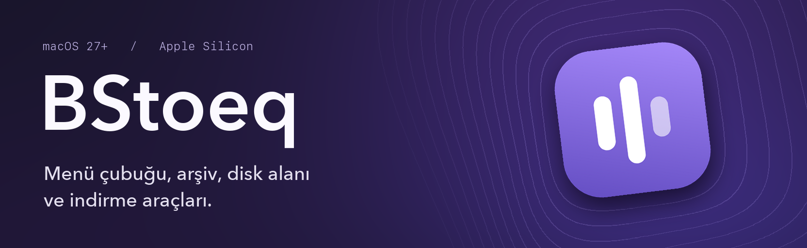
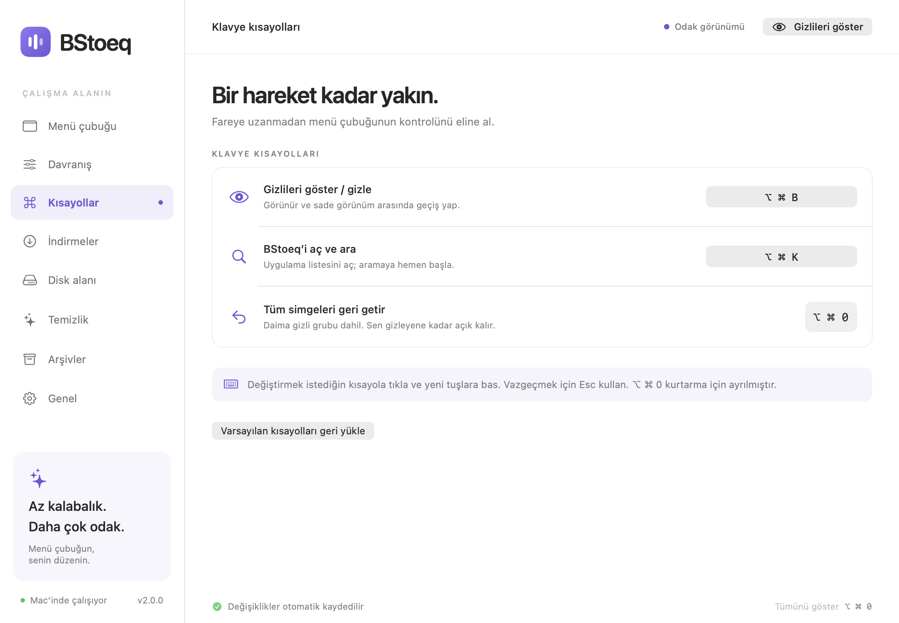

# 

BStoeq 2.0, Apple Silicon üzerinde macOS 27 için geliştirilmiş bir menü çubuğu uygulamasıdır. Menü simgelerini düzenlemek, arşiv açmak veya oluşturmak, diskte yer kaplayan öğeleri incelemek, kopya dosyaları bulmak, uygulamaları verileriyle birlikte kaldırmak ve YouTube indirmelerini yönetmek için kullanılır. Arayüz Türkçe, İngilizce ve Almancadır.

[Mac için indir](https://github.com/BSARPEL/BStoeq/releases/download/v2.0.0/BStoeq-macOS.zip) · [Medya araçlarıyla otomatik kurulum](#otomatik-kurulum) · [Arşiv özellikleri](#arşivler) · [Disk alanı ve temizlik](#disk-alanı-ve-temizlik) · [Kopya dosyalar ve uygulama kaldırma](#kopya-dosyalar-ve-uygulama-kaldırma)

<picture>
  <source media="(prefers-color-scheme: dark)" srcset="docs/images/archive-workspace-dark.png">
  
</picture>

## GitHub’dan kurulum

BStoeq için **Apple Silicon işlemcili bir Mac ve macOS 27.0 veya üstü** gerekir. İşlemcini ve macOS sürümünü ** → Bu Mac Hakkında** bölümünde görebilirsin.

### Hazır uygulamayı kurma

1. **BStoeq-macOS.zip** dosyasını indir. Hazır uygulamayı çalıştırmak için Xcode veya Homebrew gerekmez. [v2.0.0 uygulamasını indir](https://github.com/BSARPEL/BStoeq/releases/download/v2.0.0/BStoeq-macOS.zip)
2. ZIP’i açmadan önce Terminal’de `shasum -a 256 ~/Downloads/BStoeq-macOS.zip` çalıştır. Çıkan değeri sürüm sayfasındaki SHA-256 ile karşılaştır. [Sürüm ve doğrulama özeti](https://github.com/BSARPEL/BStoeq/releases/tag/v2.0.0)
3. ZIP’i Finder’da aç. Güncelleme yapıyorsan önce menü çubuğundan BStoeq’ten çık. **BStoeq.app** dosyasını **Uygulamalar** klasörüne taşı ve oradan aç.

Bu paket yerel (*ad hoc*) imzalıdır ve Apple noter onayı taşımaz. İlk açılışta yalnızca geliştiricinin doğrulanamadığı uyarısı çıkarsa, kaynağa güveniyor ve SHA-256 özetini doğruladıysan **Sistem Ayarları → Gizlilik ve Güvenlik → Yine de Aç** seçeneğini kullanabilirsin. [Apple’ın ilk açılış kılavuzu](https://support.apple.com/tr-tr/102445)

### Otomatik kurulum

**Hazır uygulamayı ve indirme araçlarını birlikte kurmak için** bu deponun **Code → Download ZIP** seçeneğiyle kaynak arşivini indir. Finder’da arşivi aç, çıkan `BStoeq-main` klasöründeki **BStoeq Kur.command** dosyasına çift tıkla. Kurulum Terminal’de çalışır. Yayımlanmış `v2.0.0` ZIP’ini indirir, SHA-256 özetini denetler, eksik medya araçlarını kurar ve uygulamayı **Uygulamalar** klasörüne yerleştirir. Tam Xcode gerekmez. [Kurucu dosyalarını indir (ana dal ZIP)](https://github.com/BSARPEL/BStoeq/archive/refs/heads/main.zip)

Aynı işlemi Terminal’den başlatmak için `cd` yazıp bir boşluk bırak, proje klasörünü Terminal’e sürükle, Return’e bas ve aşağıdaki komutu çalıştır.

```sh
./scripts/install.sh --release
```

**Ana daldaki en yeni düzeltmelerle kurmak için** proje klasöründe `./scripts/install.sh` çalıştır. Bu seçenek uygun Xcode sürümünü bulur veya kurar, uygulamayı bu klasördeki kaynak koddan derler ve yerel imzayla yükler. Git kullanıyorsan baştan sona şu komutları çalıştırabilirsin.

```sh
git clone https://github.com/BSARPEL/BStoeq.git
cd BStoeq
./scripts/install.sh
```

Betiği kendi kullanıcı hesabından çalıştır ve kurulum sırasında Terminal’i açık tut. Mevcut bir BStoeq kopyasını güncelliyorsan önce menü çubuğundaki simgeden uygulamadan çık.

- **Homebrew** yalnızca eksik bir paketi kurmak için gerekir. Mac’inde yoksa betik resmî Homebrew kurucusunu indirir. Bu kurucu gerekli Apple Komut Satırı Araçlarını da yükler. Terminal’de onay veya yönetici parolası istenebilir. [Homebrew’un kurulum belgeleri](https://docs.brew.sh/Installation)
- **Kaynaktan kurulumda uygun Xcode bulunamazsa** betik Homebrew üzerinden `mas` aracını yükler ve Mac App Store’dan Xcode’u edinmeyi veya güncellemeyi dener. App Store açılırsa Apple hesabınla orada oturum aç, Xcode’un indirilmesini tamamla ve proje klasöründe `./scripts/install.sh` komutunu tekrarla. Xcode ilk kullanım bileşenleri veya lisans onayı istiyorsa açılan Xcode penceresindeki adımları tamamla. [mas ile App Store kurulumu](https://github.com/mas-cli/mas#commands)
- **Medya indirmeleri için** kurucu, uygulamanın erişebildiği mevcut araçları kullanır. Eksikse YouTube bağlantıları için `yt-dlp` ve JavaScript çalışma ortamı `deno`, ses ve video işlemleri için `ffmpeg` ile `ffprobe` kurulur. [Homebrew yt-dlp paketi](https://formulae.brew.sh/formula/yt-dlp)

Kurulum tamamlandığında **Uygulamalar → BStoeq**’i aç veya Terminal’de şu komutu çalıştır.

```sh
open /Applications/BStoeq.app
```

İlk açılışta ayarlar penceresi ve menü çubuğu simgesi görünür. Pencereyi kapattıktan sonra simgeye sağ tıklayıp **BStoeq ayarları…** veya **Arşiv yöneticisini aç…** seçeneğini kullanabilirsin.

### Elle paketleme ve kurulum

GitHub’ın **Code → Download ZIP** ve **Source code (zip)** seçenekleri derleme için kaynak kodu içerir.

Paketi kendin oluşturmak için Swift 6 araç zincirini ve macOS 27 SDK’sını içeren tam Xcode uygulamasını kur. Xcode’u açıp ilk kullanım adımlarını tamamla. Proje klasöründe aşağıdaki komutu çalıştır. Derleme başarıyla tamamlanınca Finder’da seçilen ZIP’i aç ve **BStoeq.app** dosyasını **Uygulamalar** klasörüne taşı.

```sh
BSTOEQ_SIGNING_IDENTITY=- ./scripts/build.sh && open -R dist/BStoeq-macOS.zip
```

Yerel imza için geliştirici sertifikası gerekmez. macOS internetten indirdiğin hazır bir uygulamanın geliştiricisini doğrulayamazsa paketin kaynağını kontrol et. Kendi kopyanı bu depodan derleyebilirsin. [Apple’ın uygulama güvenliği kılavuzu](https://support.apple.com/tr-tr/102445)

### Kurulumu denetleme

- **Uygulama, Uygulamalar klasörünü açmanı istiyorsa** çıkarttığın kopyayı `/Applications/BStoeq.app` konumuna taşı ve oradan başlat.
- **Derleme sırasında SDK veya `SwiftUIMacros` hatası alırsan** macOS 27 SDK’sını içeren tam Xcode uygulamasını aç. **Xcode → Settings → Locations → Command Line Tools** bölümünde bu Xcode sürümünü seç. Terminal’de `xcrun --sdk macosx --show-sdk-version` ile SDK sürümünü kontrol edip kurulum komutunu yeniden çalıştır. [Apple’ın Xcode indirme sayfası](https://developer.apple.com/xcode/resources/)
- **Kurulu sürümü denetlemek için** aşağıdaki komutu çalıştır. Çıktıda sürüm, uygulama konumu ve Erişilebilirlik izninin durumu görünür. `MenuBarClientCore: unavailable` görünüyorsa menü simgelerini gizlemek için gereken sistem bileşeni bu macOS sürümünde kullanılamıyordur.

```sh
/Applications/BStoeq.app/Contents/MacOS/BStoeq --diagnostics
```

## Menü çubuğu

**Ayarlar → Menü çubuğu** bölümünde hangi uygulama simgelerinin görünür, gizli veya sürekli gizli kalacağını seç. Gizli öğeleri menü çubuğunda, alt panelde veya aramalı listede açabilirsin. Başka uygulamaların simgelerini sürükleyerek sıralamak veya panelden menülerini açmak istiyorsan **Sistem Ayarları → Gizlilik ve Güvenlik → Erişilebilirlik** bölümünde **BStoeq**’i etkinleştir.

### Klavye kısayolları

`⌥⌘B` gizli simgeleri gösterir veya gizler. `⌥⌘K` ayarları açıp uygulama aramasına geçer. Bu iki tuş birleşimini **Ayarlar → Kısayollar** bölümünden değiştirebilirsin. Menü çubuğunda bir simgeyi bulamadığında `⌥⌘0` tüm simgeleri geri getirir.



## Arşivler

**Arşivler** penceresinde bir arşivi aç veya pencereye sürükle. Dosyaları ada göre ara, önizle, bütünlüğünü test et veya seçtiklerini yeni bir klasöre çıkart. Yeni arşiv oluştururken dosyaları ya da klasörleri seçip biçim ve sıkıştırma düzeyini ayarlayabilirsin.

- Birlikte gelen **7-Zip** motoruyla ZIP, 7z, TAR, TAR.GZ, TAR.BZ2 ve TAR.XZ oluşturulabilir. RAR4 ve RAR5 dosyaları açılabilir ve çıkartılabilir.
- ZIP ve 7z arşivlerinde AES-256 şifreleme ve çok parçalı çıktı desteklenir. Çok parçalı bir arşivi okumak için parçaları aynı klasöre koyup `.001` dosyasını aç.
- Şifresiz, tek parçalı ZIP, 7z ve TAR arşivlerine dosya ekleyebilir, arşiv içindeki dosyaları silebilir veya yeniden adlandırabilirsin. Düzenleme tamamlanınca özgün arşiv `.backup` olarak saklanır.
- RAR oluşturmak veya onarmak istiyorsan RARLAB’ın ayrı lisanslanan `rar` aracını edin ve arşiv ayarlarında seç. [RARLAB lisans koşulları](https://www.rarlab.com/license.htm)

Çıkartma yeni bir klasörde tamamlanır. Dışarıya yazabilecek yollar, çakışan dosya adları ve bağlantı içeren arşivler hata olarak bildirilir. Arşiv penceresinde **⌘O** açar, **⌘N** yeni arşiv oluşturur, **⌘E** çıkartır ve **⌘T** bütünlüğü test eder. Finder’da bir arşive sağ tıklayarak **Servisler** menüsünden açma, çıkartma ve test işlemlerine ulaşabilirsin.

## Disk alanı ve temizlik

**Ayarlar → Disk alanı** altında bir disk, ev klasörü veya seçtiğin bir klasörü tara. Sonuçlar diskte kapladıkları alana göre sıralanır. Klasörlere girerek alanı hangi dosyaların kullandığını görebilirsin.

**Ayarlar → Temizlik** taramayı dosya türüne ve konuma göre yürütür.

- Kullanıcı ve uygulama kapsayıcılarındaki önbellekler, tanınan Chromium ve Electron önbellekleri.
- Arşivlenmiş günlükler, eski tanılama raporları, Xcode ara dosyaları ve npm, pip, Gradle önbelleklerinin desteklenen bölümleri.
- İndirilenler klasöründeki eski `.dmg`, `.pkg`, `.mpkg` ve `.xip` dosyaları.
- `/Applications` ve `~/Applications` içindeki, macOS’un kaydettiği son kullanım tarihi seçilen eşikten eski olan uygulamalar. Varsayılan eşik **180 gün** olup **30** ve **90 gün** de seçilebilir.

Dosyalarda hem son erişimin hem de son değişikliğin üzerinden en az 30 gün geçmiş olmalıdır. Uygulamalarda tarih kaydı eksikse paketi Finder’da inceleyebilirsin. Çalışan uygulamalar, Apple uygulamaları ve yakın zamanda güncellenen paketler taşıma adaylarından çıkarılır.

Tarama sonunda neyin taşınacağını sen seçersin. BStoeq seçilenleri yeniden denetler ve onayladıklarını **Çöp Sepeti’ne** taşır. Uygulama temizliği seçilen `.app` paketini kapsar. Öğeleri sepetten geri alabilirsin. Alan sepet boşaltıldığında açılır. Disk taraması okunamayan klasörler bildirirse erişebildiğin bir klasörü seçebilirsin. Korumalı konumları da taramak istiyorsan **Sistem Ayarları → Gizlilik ve Güvenlik → Tam Disk Erişimi** bölümünde BStoeq’e izin verip taramayı tekrarla.

## Kopya dosyalar ve uygulama kaldırma

**Ayarlar → Kopya dosyalar** altında ev klasörünü, İndirilenler’i veya seçtiğin bir klasörü tara. BStoeq önce aynı boyuttaki dosyaları bulur, ardından içeriklerini SHA-256 özetiyle karşılaştırır. Yalnızca içeriği birebir aynı olan dosyalar aynı grupta gösterilir. Adı veya tarihi farklı olan kopyalar da bulunur. Karşılaştırılacak en küçük dosya boyutunu taramadan önce seçebilirsin. Varsayılan değer **1 MB**’tır.

- Gizli öğeler, `~/Library` klasörü ve uygulama ya da fotoğraf arşivi gibi paketler taranmaz. Yalnızca bulutta duran dosyalar indirilmez ve karşılaştırılmaz.
- Sembolik bağlantılar izlenmez. Aynı dosyanın sabit bağlantıları (*hard link*) kopya sayılmaz.
- Her grupta en az bir dosya işaretsiz kalır. **Her grupta en eskisini tut, diğerlerini seç** bağlantısı her gruptaki en eski dosya dışındakileri işaretler.
- Taşımadan önce hem seçilen dosya hem de yerinde kalacak kopya yeniden denetlenir. Taramadan sonra değişen dosyalar atlanır.

**Ayarlar → Uygulama kaldır** bölümü `/Applications` ve `~/Applications` içindeki üçüncü taraf uygulamaları listeler. **İncele** düğmesi uygulamanın boyutunu ölçer ve `~/Library` altında uygulamanın paket kimliğiyle birebir eşleşen verileri arar. Bunlar uygulama verileri, önbellek, tercihler, kayıtlı pencere durumu, web verileri, günlükler, korumalı alan kapsayıcısı ve başlangıç öğesidir. Kimlikle eşleşenler işaretli gelir. Yalnızca uygulamanın adıyla eşleşen klasörler **Ada göre** etiketiyle ve işaretsiz gösterilir.

Apple uygulamaları ve BStoeq listelenmez. Açık bir uygulama kaldırılmaz. Aynı kimliği kullanan başka bir kopya kuruluysa ortak verileri yerinde kalır. **Kaldır…** onayından sonra uygulama ve seçtiğin veriler **Çöp Sepeti’ne** taşınır. App Store’dan veya bir yükleyiciyle kurulan uygulamalarda taşıma işini Finder üstlenir ve macOS yönetici onayı isteyebilir. Uygulama taşınamazsa verilerine dokunulmaz.

## Video ve müzik indirme

**Ayarlar → İndirmeler** bölümüne bir YouTube videosu veya oynatma listesi bağlantısı yapıştır. Video için çözünürlüğü, ses için MP3 veya M4A biçimini ve kayıt klasörünü seçebilirsin. İndirmeler yerel `yt-dlp` aracını, ses dönüştürme ve akış birleştirme işlemleri `ffmpeg` aracını kullanır. Otomatik kurulum her ikisini de yükler. Elle kurulum yaptıysan ve Homebrew kullanıyorsan araçları şu komutla ekleyebilirsin.

```sh
brew install yt-dlp ffmpeg
```

Kurulumdan sonra **Ayarlar → İndirmeler → Yeniden denetle** düğmesine bas. Yalnızca `yt-dlp` kuruluysa uygulama, ses ve görüntüsü birleştirilmiş videoları veya hazır ses dosyalarını indirebilir. MP3 dönüşümü ve ayrı ses ile görüntü akışlarını birleştirmek için `ffmpeg` gerekir.

## Proje ve bileşenler

SwiftUI ve AppKit arayüzü, SwiftPM hedefleri ve gömülü arşiv motorunun dağıtım dosyaları bu projede bulunur. Geliştirme ve test adımları ile paketlenen üçüncü taraf bileşenlerin kaynakları ayrı belgelerde açıklanır. [Katkı kılavuzu](CONTRIBUTING.md) · [Üçüncü taraf bildirimleri](THIRD_PARTY_NOTICES.md)
