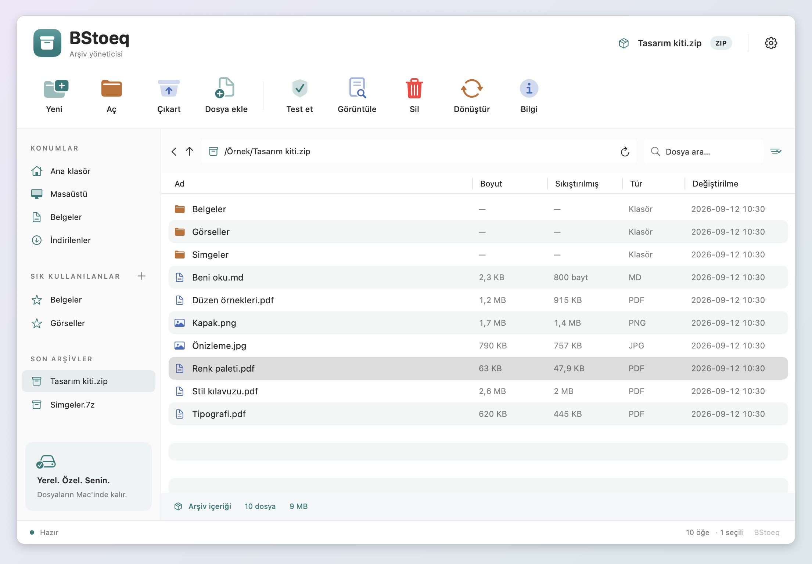

# 

**English** · [Türkçe](README.tr.md)

BStoeq 2.1 is a menu bar app for macOS 27 on Apple Silicon. Use it to arrange menu bar icons, open or create archives, convert files where they are, see what takes up disk space, find duplicate files, uninstall apps together with their data, and manage YouTube downloads. The interface is available in Turkish, English and German.

[Download for Mac](https://github.com/BSARPEL/BStoeq/releases/download/v2.1.1/BStoeq-macOS.zip) · [Automatic setup with media tools](#automatic-setup) · [Installer package](#building-an-installer-package) · [File converter](#converting-files) · [Archive features](#archives) · [Disk space and cleanup](#disk-space-and-cleanup) · [Duplicate files and uninstalling apps](#duplicate-files-and-uninstalling-apps)

<picture>
  <source media="(prefers-color-scheme: dark)" srcset="docs/images/archive-workspace-dark.png">
  
</picture>

## Installing from GitHub

BStoeq needs **a Mac with Apple Silicon and macOS 27.0 or later**. You can see your processor and macOS version under **Apple menu → About This Mac**.

### Installing the ready-made app

1. Download **BStoeq-macOS.zip**. Running the ready-made app needs neither Xcode nor Homebrew. [Download the v2.1.1 app](https://github.com/BSARPEL/BStoeq/releases/download/v2.1.1/BStoeq-macOS.zip)
2. Before opening the ZIP, run `shasum -a 256 ~/Downloads/BStoeq-macOS.zip` in Terminal. Compare the result with the SHA-256 on the release page. [Release and verification summary](https://github.com/BSARPEL/BStoeq/releases/tag/v2.1.1)
3. Open the ZIP in Finder. If you are updating, quit BStoeq from the menu bar first. Move **BStoeq.app** to the **Applications** folder and open it from there.

This package is signed locally (*ad hoc*) and is not notarized by Apple. If the first launch only warns that the developer cannot be verified, and you trust the source and have checked the SHA-256 digest, you can use **System Settings → Privacy & Security → Open Anyway**. [Apple’s guide to opening apps for the first time](https://support.apple.com/102445)

### Automatic setup

**To install the ready-made app and the download tools together**, download the source archive of this repository with **Code → Download ZIP**. Open the archive in Finder and double-click **BStoeq Kur.command** in the resulting `BStoeq-main` folder. The setup runs in Terminal. It downloads the published `v2.1.1` ZIP, checks its SHA-256 digest, installs any missing media tools and places the app in the **Applications** folder. Full Xcode is not needed. [Download the installer files (main branch ZIP)](https://github.com/BSARPEL/BStoeq/archive/refs/heads/main.zip)

To start the same process from Terminal, type `cd` followed by a space, drag the project folder into Terminal, press Return and run the command below.

```sh
./scripts/install.sh --release
```

**To install with the newest fixes on the main branch**, run `./scripts/install.sh` in the project folder. This option finds or installs a suitable Xcode, builds the app from the source in this folder and installs it with a local signature. If you use Git, you can run these commands from start to finish.

```sh
git clone https://github.com/BSARPEL/BStoeq.git
cd BStoeq
./scripts/install.sh
```

Run the script from your own user account and keep Terminal open during setup. If you are updating an existing copy of BStoeq, quit the app from its menu bar icon first.

- **Homebrew** is needed only to install a missing package. If your Mac does not have it, the script downloads the official Homebrew installer, which also installs the required Apple Command Line Tools. Terminal may ask for confirmation or an administrator password. [Homebrew installation documentation](https://docs.brew.sh/Installation)
- **If no suitable Xcode is found when installing from source**, the script installs the `mas` tool through Homebrew and tries to get or update Xcode from the Mac App Store. If the App Store opens, sign in there with your Apple Account, let Xcode finish downloading and run `./scripts/install.sh` in the project folder again. If Xcode asks for first-launch components or a license agreement, complete the steps in the Xcode window that opens. [Installing from the App Store with mas](https://github.com/mas-cli/mas#commands)
- **For media downloads**, the installer uses the existing tools the app can reach. If they are missing, it installs `yt-dlp` and the JavaScript runtime `deno` for YouTube links, and `ffmpeg` with `ffprobe` for audio and video processing. [Homebrew yt-dlp package](https://formulae.brew.sh/formula/yt-dlp)

When setup finishes, open **Applications → BStoeq** or run this command in Terminal.

```sh
open /Applications/BStoeq.app
```

On first launch the settings window and the menu bar icon appear. After closing the window, right-click the icon and choose **BStoeq Settings…** or **Open archive manager…**.

### Packaging and installing by hand

GitHub’s **Code → Download ZIP** and **Source code (zip)** options contain the source code for building.

To build the package yourself, install the full Xcode app with the Swift 6 toolchain and the macOS 27 SDK. Open Xcode and complete its first-launch steps. Run the command below in the project folder. When the build succeeds, open the ZIP selected in Finder and move **BStoeq.app** to the **Applications** folder.

```sh
BSTOEQ_SIGNING_IDENTITY=- ./scripts/build.sh && open -R dist/BStoeq-macOS.zip
```

A local signature needs no developer certificate. If macOS cannot verify the developer of a ready-made app you downloaded from the internet, check where the package came from. You can build your own copy from this repository. [Apple’s guide to app security](https://support.apple.com/102445)

### Building an installer package

To hand BStoeq to someone as a double-click installer, build **BStoeq-macOS.pkg**. The command below builds the app as described above and wraps it in a standard macOS installer package.

```sh
BSTOEQ_SIGNING_IDENTITY=- ./scripts/package-installer.sh && open -R dist/BStoeq-macOS.pkg
```

Double-clicking the package opens Installer. It asks for an administrator password and places **BStoeq.app** in the **Applications** folder, so the app starts from the location it expects. The package installs on the startup disk of an Apple Silicon Mac with macOS 27.0 or later.

- **To package a copy you already have**, pass it to the script. For example, after checking the SHA-256 of the published ZIP, run `./scripts/package-installer.sh ~/Downloads/BStoeq-macOS.zip`. A `BStoeq.app` bundle is accepted as well.
- **When updating**, quit BStoeq from its menu bar icon first. The installer stops if the app is still running. A previous copy in the Applications folder is replaced as a whole and your settings are kept.
- **The package contains only the app.** To download video and music, add `yt-dlp` and `ffmpeg` afterwards. [Downloading video and music](#downloading-video-and-music)
- **The package is unsigned** unless you set `BSTOEQ_INSTALLER_IDENTITY` to a *Developer ID Installer* certificate in your keychain. macOS warns about an unsigned package that was downloaded from the internet. If you trust where it came from, use **System Settings → Privacy & Security → Open Anyway**.

### Checking the installation

- **If the app asks you to open the Applications folder**, move the extracted copy to `/Applications/BStoeq.app` and start it from there.
- **If the build fails with an SDK or `SwiftUIMacros` error**, open the full Xcode app that includes the macOS 27 SDK. Select that Xcode under **Xcode → Settings → Locations → Command Line Tools**. Check the SDK version in Terminal with `xcrun --sdk macosx --show-sdk-version` and run the setup command again. [Apple’s Xcode download page](https://developer.apple.com/xcode/resources/)
- **To check the installed version**, run the command below. The output shows the version, the app’s location and the state of the Accessibility permission. If it shows `MenuBarClientCore: unavailable`, the system component needed to hide menu bar icons cannot be used on this macOS version.

```sh
/Applications/BStoeq.app/Contents/MacOS/BStoeq --diagnostics
```

## Menu bar

Under **Settings → Menu bar**, choose which app icons stay visible, hidden or always hidden. You can open hidden items in the menu bar, in a panel below it or in a searchable list. To reorder other apps’ icons by dragging, or to open their menus from the panel, enable **BStoeq** under **System Settings → Privacy & Security → Accessibility**.

### Keyboard shortcuts

`⌥⌘B` shows or hides the hidden icons. `⌥⌘K` opens the settings and moves to the app search. You can change these two shortcuts under **Settings → Shortcuts**. When you cannot find an icon in the menu bar, `⌥⌘0` brings every icon back.


## Archives

In the **Archives** window, open an archive or drag one onto the window. Search files by name, preview them, test the archive’s integrity or extract your selection to a new folder. When creating an archive, choose files or folders and set the format and compression level.

- The bundled **7-Zip** engine creates ZIP, 7z, TAR, TAR.GZ, TAR.BZ2 and TAR.XZ. RAR4 and RAR5 files can be opened and extracted.
- ZIP and 7z archives support AES-256 encryption and multi-part output. To read a multi-part archive, put the parts in one folder and open the `.001` file.
- You can add files to unencrypted, single-part ZIP, 7z and TAR archives, and delete or rename files inside them. When the edit finishes, the original archive is kept as `.backup`.
- To create or repair RAR files, get RARLAB’s separately licensed `rar` tool and select it in the archive settings. [RARLAB license terms](https://www.rarlab.com/license.htm)

Extraction finishes in a new folder. Paths that could write outside it, clashing file names and archives containing links are reported as errors. In the archive window **⌘O** opens, **⌘N** creates a new archive, **⌘E** extracts and **⌘T** tests integrity. In Finder, right-click an archive to reach opening, extracting and testing from the **Services** menu.

## Disk space and cleanup

Under **Settings → Disk space**, scan a disk, your home folder or a folder you choose. Results are ordered by the space they take on disk. Open folders to see which files use the space.

**Settings → Cleanup** runs the scan by file type and location.

- Caches in user and app containers, and recognized Chromium and Electron caches.
- Archived logs, old diagnostic reports, Xcode intermediate files and the supported parts of the npm, pip and Gradle caches.
- Old `.dmg`, `.pkg`, `.mpkg` and `.xip` files in the Downloads folder.
- Apps in `/Applications` and `~/Applications` whose last-used date recorded by macOS is older than the chosen threshold. The default threshold is **180 days**; **30** and **90 days** can also be chosen.

For files, at least 30 days must have passed since both the last access and the last change. If an app has no usage record, you can inspect the bundle in Finder. Running apps, Apple’s apps and recently updated bundles are left out of the candidates.

After the scan you choose what to move. BStoeq checks the selection again and moves what you approve to the **Trash**. App cleanup covers the selected `.app` bundle. You can put items back from the Trash. The space is freed when the Trash is emptied. If the disk scan reports unreadable folders, you can choose a folder you have access to. To scan protected locations as well, allow BStoeq under **System Settings → Privacy & Security → Full Disk Access** and repeat the scan.

## Duplicate files and uninstalling apps

Under **Settings → Duplicate files**, scan your home folder, Downloads or a folder you choose. BStoeq first finds files of the same size, then compares their contents by SHA-256 digest. Only files with exactly the same content are shown in one group. Copies with a different name or date are found as well. You can choose the smallest file size to compare before scanning. The default is **1 MB**.

- Hidden items, the `~/Library` folder and packages such as apps or photo libraries are not scanned. Files kept only in the cloud are neither downloaded nor compared.
- Symbolic links are not followed. Hard links to the same file do not count as copies.
- At least one file in every group stays unticked. The **Keep the oldest in each group, select the rest** link ticks everything except the oldest file of each group.
- Before moving, both the selected file and the copy that stays are checked again. Files that changed after the scan are skipped.

**Settings → Uninstall apps** lists the third-party apps in `/Applications` and `~/Applications`. The **Inspect** button measures the app and looks under `~/Library` for data that matches the app’s bundle identifier exactly. This covers app data, caches, preferences, saved window state, web data, logs, the sandbox container and a launch agent. Matches by identifier come ticked. Folders that match only the app’s name are shown with a **By name** label and unticked.

Apple’s apps and BStoeq are not listed. An open app is not removed. If another installed copy uses the same identifier, their shared data stays in place. After you confirm **Remove…**, the app and the data you selected are moved to the **Trash**. For apps installed from the App Store or by an installer, Finder takes over the move and macOS may ask for an administrator’s approval. If the app cannot be moved, its data is not touched.

## Permissions

The **Settings → Permissions** page shows the macOS permissions BStoeq uses and the state of each. Every permission is optional. Hiding icons needs none of them.

- The state of **Accessibility** and **Full Disk Access** is read automatically. The page refreshes when you come back from System Settings.
- For the **Desktop**, **Documents** and **Downloads** folders, press **Check**. If macOS has not asked about that folder before, it shows its permission prompt. Granting Full Disk Access covers these folders too.
- macOS does not report the state of the **App Management** permission. The button on the page opens the matching section of System Settings.

## Converting files

Hold **Option** after you start dragging files in Finder: a ring of formats opens at the pointer. Drop the files on a slice and the converted copies are saved next to the originals. Scroll, or rest on **More**, to turn the ring to its other side with tools such as half size, compress, remove background and text recognition (OCR). Drop in the middle to cancel. You can switch the ring off, use Shift instead or allow drags from every app under **Settings → Converter**; the status-item menu also has **Convert while dragging**.

The **Converter** page takes files by drag and drop or **Choose file…**, lists every target that fits them, and shows running and recent conversions. A conversion can be undone: its results go to the Trash as long as you have not changed them. In Finder, right-click files and choose **Services → Convert with BStoeq…** to open them on this page. **Watched folders** convert every new file that lands in a folder; the results are saved in a "Converted" folder inside it.

- **Images:** JPG, PNG, HEIC, AVIF, TIFF, GIF, BMP, JPEG 2000, ICO and ICNS, and PDF. WebP needs `cwebp` (`brew install webp`).
- **PDF:** pages to images or text, split, merge (bookmarks and internal links are kept), compress, and OCR for scans.
- **Documents:** Word, RTF, ODT, HTML, Markdown and text to PDF, DOCX, RTF, ODT, HTML or TXT. Word documents carry styled text only; pictures and tables are not taken over.
- **Spreadsheets and data:** CSV, TSV, XLSX, JSON and property lists. Dates in Excel files come out as dates.
- **Video and audio:** MP4, MOV, GIF, M4A, ALAC, WAV, AIFF, FLAC and iPhone ringtones without extra software. MP3, Opus, WebM and MKV need `ffmpeg`. HDR video from an iPhone is converted to standard range for H.264 and kept as HDR for HEVC.
- **Subtitles:** SRT and WebVTT.

Nothing is uploaded and an existing file is never replaced: a result whose name is taken gets a number. Originals stay where they are unless you turn on **Move the original to the Trash after format conversions**.

## Downloading video and music

Paste a YouTube video or playlist link under **Settings → Downloads**. Choose the resolution for video, MP3 or M4A for audio, and the folder to save to. Downloads use the local `yt-dlp` tool; audio conversion and stream merging use `ffmpeg`. The automatic setup installs both. If you installed by hand and use Homebrew, add the tools with this command.

```sh
brew install yt-dlp ffmpeg
```

After installing, press **Settings → Downloads → Check again**. With only `yt-dlp` installed, the app can download videos whose audio and picture are already merged, or ready-made audio files. Converting to MP3 and merging separate audio and video streams need `ffmpeg`.

## Project and components

The SwiftUI and AppKit interface, the SwiftPM targets and the distribution files of the embedded archive engine live in this project. Development and test steps, and the sources of the bundled third-party components, are described in separate documents, currently in Turkish. [Contributing guide](CONTRIBUTING.md) · [Third-party notices](THIRD_PARTY_NOTICES.md)
